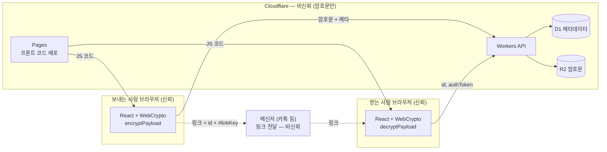

# Hashbox 위협 모델

> 무엇을, 누구로부터, 어떻게 지키는지 정리한 문서다. 설계는 Notion 「Hashbox 개발 기획서」 5·9장, 「아이디어 기획서」 5-4를 따른다.
> 구현 상태는 2026-11-21 기준 `dev` 및 진행 중 브랜치(`feat/crypto-poc`, `feat/env-parser`, `feat/text-share-api`, `feat/send`, `chore/deploy-pipeline`)를 보고 적었다. 머지되면 상태 열을 갱신한다.

## 1. 한 줄 요약

**서버는 암호문만 보관하고 열쇠는 한 번도 보지 못한다.** 열쇠는 링크의 `#` 뒤에만 있고, 암호화·복호화는 브라우저에서만 일어난다. 유출을 완전히 막을 수는 없으므로 **노출 시간을 줄이고(만료·열람 횟수), 유출을 알아챌 수 있게(“이미 열람됨”)** 만든다.

## 2. 시스템과 신뢰 경계

| 경계              | 넘어가는 것                                                   | 넘어가면 안 되는 것                          |
| ----------------- | ------------------------------------------------------------- | -------------------------------------------- |
| 브라우저 → API    | 암호문, `kind`, `size`, 만료·횟수, salt·iter, `authToken`     | 평문, 파일명, `linkKey`, 비밀번호, `pwKey`   |
| 브라우저 → 메신저 | 받기 링크(`/s/{id}#{linkKey}`), 관리 링크(`/m#{manageToken}`) | 비밀번호 (다른 채널로 전달)                  |
| Pages → 브라우저  | 프론트 JS                                                     | — (이 경계가 뚫리면 전부 무너진다. 6장 참고) |

## 3. 보호 대상 (자산)

| 자산                                                   | 어디에 있나                         | 서버가 아나                | 유출 시 피해                                   |
| ------------------------------------------------------ | ----------------------------------- | -------------------------- | ---------------------------------------------- |
| 평문 (.env 값, 키, 파일 내용)                          | 보내는·받는 브라우저 메모리         | ❌                         | **치명적** — 지키려는 대상 그 자체             |
| 파일명·MIME                                            | 암호문 안의 평문 헤더               | ❌                         | 중간 — 무엇을 보냈는지 드러남                  |
| `linkKey` (32B)                                        | 링크 `#` 뒤                         | ❌ (fragment는 전송 안 됨) | 높음 — 비밀번호 없는 상자는 바로 열림          |
| 비밀번호 / `pwKey`                                     | 사람 머리 / 브라우저 메모리         | ❌                         | 높음 — 링크와 합쳐지면 열림                    |
| `authToken`                                            | 열 때만 전송, 서버는 SHA-256만 저장 | 해시만                     | 낮음 — 이걸로는 못 푼다. 횟수 차감만 가능      |
| `manageToken`                                          | 관리 링크 `#` 뒤, 서버는 해시만     | 해시만                     | 중간 — 상태 열람·즉시 파기 가능 (내용은 못 봄) |
| `uploadToken`                                          | 보내는 브라우저, 1회용              | 해시만                     | 낮음 — 업로드 전 1시간 동안만 의미             |
| 메타데이터 (`kind`, `size`, 시각, 횟수, 비밀번호 유무) | D1                                  | ✅                         | 낮음 — 의도적으로 노출을 허용한 항목           |
| Cloudflare API 토큰                                    | GitHub Secrets                      | —                          | **치명적** — 배포 장악 → 프론트 변조 가능      |

## 4. 공격자 모델

| ID  | 공격자                                                       | 할 수 있는 것               | 대표 시나리오                                          |
| --- | ------------------------------------------------------------ | --------------------------- | ------------------------------------------------------ |
| A1  | **서버·저장소 탈취** (D1·R2 덤프, Cloudflare 계정 일부 권한) | DB·암호문 열람, 응답 위조   | DB 백업 유출, 내부자                                   |
| A2  | **링크를 손에 넣은 사람**                                    | 링크로 조회·열기 시도       | 단톡방 오발송, 카톡 기록 동기화된 다른 기기, 어깨 너머 |
| A3  | **링크 미리보기 봇**                                         | 링크를 자동으로 GET         | 카톡·슬랙 미리보기                                     |
| A4  | **네트워크 도청자**                                          | 트래픽 관찰·변조 시도       | 공용 와이파이                                          |
| A5  | **인터넷의 아무나**                                          | 무작위 요청, 대량 요청      | 상자 id 추측, 서비스 마비, 불법 파일 보관              |
| A6  | **프론트 배포 경로 장악**                                    | 사용자에게 내려가는 JS 변경 | Cloudflare/GitHub 토큰 유출, 악성 의존성               |
| A7  | **받는 사람 자신 / 받는 사람 기기의 악성코드**               | 화면·클립보드·메모리 접근   | 캡처, 악성 확장 프로그램                               |

## 5. 위협별 대응

상태: ✅ 구현됨(브랜치 포함) · 🟡 진행 중/부분 · ⬜ 미구현

### 5-1. 기밀성 (내용을 몰래 보기)

| #   | 위협                                                                 | 공격자 | 대응                                                                                                                           | 구현 위치                               | 상태                             |
| --- | -------------------------------------------------------------------- | ------ | ------------------------------------------------------------------------------------------------------------------------------ | --------------------------------------- | -------------------------------- |
| C1  | 서버 DB·R2를 털어 내용 보기                                          | A1     | 브라우저에서 AES-256-GCM 암호화, 열쇠는 `#` 뒤에만 → 서버에 열쇠 없음                                                          | `shared/crypto`                         | ✅                               |
| C2  | 파일명으로 무엇을 보냈는지 추측                                      | A1     | 파일명·MIME을 평문 헤더에 넣어 **함께 암호화**                                                                                 | `crypto/format.ts`                      | ✅                               |
| C3  | 비밀번호 상자에서 서버가 `authToken`으로 내용 풀기                   | A1     | PBKDF2 출력 64B를 `pwKey`/`authToken`으로 분리, contentKey는 `HKDF(linkKey‖pwKey)` → `authToken`만으론 못 품                   | `crypto/keys.ts`                        | ✅                               |
| C4  | 서버가 `iter=1` 같은 약한 KDF 파라미터를 내려줘 비밀번호를 쉽게 깨기 | A1     | 받는 쪽이 `600,000 ≤ iter ≤ 10,000,000`, salt 16B 아니면 거부 / 서버도 생성 시 `iter == 600000`만 허용                         | `crypto/keys.ts`, `api/lib/validate.ts` | ✅                               |
| C5  | 저장된 `authToken` 해시로 비밀번호 오프라인 대입                     | A1     | salt + PBKDF2 60만 회 → 후보 하나당 비용 큼. 강한 비밀번호 권장 문구                                                           | `crypto/keys.ts`                        | ✅ (남은 위험: 약한 비밀번호)    |
| C6  | 도청으로 내용·토큰 탈취                                              | A4     | HTTPS 강제 + HSTS, 내용은 이미 암호문                                                                                          | Pages·Workers 기본 TLS, `_headers`      | ✅                               |
| C7  | 브라우저 방문 기록·주소창에 열쇠가 남음                              | A2, A7 | `#` 뒤를 앱 시작 시 한 번 읽고 즉시 `history.replaceState`로 제거                                                              | `web/lib/fragment.ts`                   | ✅                               |
| C8  | Referer 헤더로 링크가 외부에 새어나감                                | A2     | `Referrer-Policy: no-referrer`, 외부 리소스 없음                                                                               | `_headers`                              | ✅                               |
| C9  | 복호화한 값이 브라우저 저장소에 남음                                 | A7     | 결과는 React state에만, localStorage 등 저장 금지, `dangerouslySetInnerHTML` 금지                                              | FE 규칙 (`feat/send`에 위반 없음 확인)  | 🟡 받기 화면(#19) 구현 시 재확인 |
| C10 | 링크 통째로 유출 (비밀번호 없는 상자)                                | A2     | 막을 수 없음 → **짧은 만료(기본 1시간) + 1회 열람(기본) + “이미 열람됨” 감지 + 키 교체 안내**. 민감하면 비밀번호를 다른 채널로 | 서버 원자적 차감, 받기 화면             | 🟡 서버 ✅ / 화면 #19            |
| C11 | 서버 로그에 평문·토큰이 남음                                         | A1     | 요청 본문·토큰 로깅 금지, 오류 시 고정 문구만 `console.error`                                                                  | `api/src/index.ts`, `share-service.ts`  | ✅ (#37에서 점검)                |
| C12 | 상자 id를 추측해 남의 상자 찾기                                      | A5     | id 12B 랜덤(96비트) → 추측 불가. 찾아도 열쇠가 없어 못 품                                                                      | `api/lib/tokens.ts`                     | ✅                               |

### 5-2. 무결성 (내용 바꿔치기)

| #   | 위협                               | 공격자 | 대응                                                                                                   | 상태             |
| --- | ---------------------------------- | ------ | ------------------------------------------------------------------------------------------------------ | ---------------- |
| I1  | 서버가 암호문을 바꿔서 전달        | A1     | AES-GCM 인증 태그 → 1비트만 바뀌어도 `DecryptError` (“열쇠가 맞지 않아요”)                             | ✅ 테스트로 확인 |
| I2  | 다른 상자의 암호문으로 바꿔치기    | A1     | 상자마다 `linkKey`가 달라 다른 암호문은 복호화 실패                                                    | ✅               |
| I3  | 업로드 가로채서 다른 암호문 올리기 | A5     | 1회용 `uploadToken`(해시만 저장, 상수 시간 비교), 업로드 후 무효화, 크기는 등록값과 정확히 일치해야 함 | ✅               |
| I4  | 옛날·미래 포맷 혼동                | —      | 저장 포맷 맨 앞 버전 바이트(`0x01`), 모르는 버전은 거부                                                | ✅               |

### 5-3. 열람 통제 (횟수·만료·잠금)

| #   | 위협                                           | 공격자 | 대응                                                                                                    | 상태                           |
| --- | ---------------------------------------------- | ------ | ------------------------------------------------------------------------------------------------------- | ------------------------------ |
| V1  | 미리보기 봇이 링크를 열어 1회 열람을 소진      | A3     | 조회(`GET /api/shares/{id}`)는 차감 없음, “열기” 버튼(`POST .../open`)에서만 차감. OG 태그는 고정 문구  | ✅                             |
| V2  | 동시에 여러 명이 눌러 횟수보다 많이 열람       | A2     | `UPDATE ... WHERE views_left > 0 ... RETURNING` 한 쿼리로 원자적 차감. 차감에 성공한 요청만 암호문 수신 | ✅ (#37에서 동시 10회 테스트)  |
| V3  | 링크만 가진 사람이 비밀번호 상자의 횟수를 소진 | A2     | `authToken` 해시가 맞을 때만 차감 (`auth_hash = ?` 조건)                                                | ✅                             |
| V4  | 비밀번호 무차별 대입                           | A2     | 5회 실패 시 `locked` + 암호문 삭제                                                                      | ✅                             |
| V5  | 만료·소진 후에도 암호문이 남음                 | A1     | 종결 즉시 R2 삭제, 실패 시 Cron(10분) 재시도, R2 수명주기 규칙(8일) 백업                                | 🟡 수명주기 규칙은 인프라(#23) |
| V6  | 관리 링크 탈취로 남의 상자 파기                | A2     | 관리 토큰 32B 랜덤·해시 저장. 탈취돼도 내용은 못 봄 (가용성만 피해)                                     | ✅                             |

### 5-4. 가용성·악용

| #   | 위협                                                  | 공격자 | 대응                                                                                                 | 상태      |
| --- | ----------------------------------------------------- | ------ | ---------------------------------------------------------------------------------------------------- | --------- |
| D1  | 상자 생성·열기 대량 요청으로 무료 한도 소진           | A5     | IP당 요청 속도 제한                                                                                  | ⬜ #32    |
| D2  | 큰 본문으로 메모리 공격                               | A5     | 등록 `size`·`maxBlobBytes` 초과 즉시 거부, 업로드는 등록 크기 이상 읽지 않음                         | ✅        |
| D3  | 링크를 가진 사람이 일부러 비밀번호 5번 틀려 상자 파괴 | A2     | **의도된 트레이드오프**: 무차별 대입 방지(V4)가 우선. 받는 사람에게 “잠김”이 보이면 유출 신호로 취급 | ✅ (수용) |
| D4  | 불법 파일 보관·배포 창구로 악용                       | A5     | 파일 25MB, 최대 7일, 최대 10회 열람                                                                  | ✅        |
| D5  | 비정상적으로 큰 헤더·.env 입력으로 브라우저 멈춤      | A5     | 헤더 1024B 제한, .env 파서 입력 크기에 선형                                                          | ✅        |

### 5-5. 프론트·배포 경로

| #   | 위협                                    | 공격자 | 대응                                                                               | 상태                                                     |
| --- | --------------------------------------- | ------ | ---------------------------------------------------------------------------------- | -------------------------------------------------------- |
| F1  | XSS로 열쇠·평문 탈취                    | A5     | CSP `script-src 'self'`, 외부 스크립트·CDN 폰트 금지, 텍스트로만 렌더링            | 🟡 CSP `connect-src`가 아직 placeholder → #13 머지 + #31 |
| F2  | 다른 사이트가 iframe으로 감싸 클릭 유도 | A5     | `frame-ancestors 'none'`                                                           | ✅                                                       |
| F3  | 배포 토큰 탈취로 프론트 변조            | A6     | 토큰은 wrangler 실행 단계에만 노출, CI 통과 후에만 배포                            | ⬜ PR #13 리뷰 반영 필요                                 |
| F4  | 악성 npm 의존성                         | A6     | `pnpm install --frozen-lockfile`, 빌드 스크립트 허용 목록(`onlyBuiltDependencies`) | 🟡                                                       |
| F5  | 받기 링크·관리 페이지가 검색에 노출     | A5     | `/s/*`, `/m`에 `X-Robots-Tag: noindex`                                             | ✅                                                       |

## 6. 막을 수 없는 것 (남은 위험)

| 남은 위험                                  | 이유                                                                                                                                  | 완화                                                                                                              |
| ------------------------------------------ | ------------------------------------------------------------------------------------------------------------------------------------- | ----------------------------------------------------------------------------------------------------------------- |
| **받는 사람의 캡처·복사·유출**             | 복호화해서 보여준 순간부터는 받는 사람을 믿을 수밖에 없다                                                                             | “닫으면 다시 못 봐요” 경고, 값 기본 가림                                                                          |
| **프론트 코드 변조 (A6)**                  | 웹 E2EE의 구조적 한계. 암호화 코드도 접속할 때마다 서버(Pages)에서 받아온다. 배포 경로가 장악되면 열쇠를 빼돌리는 코드를 심을 수 있다 | 프론트(Pages)와 API(Workers) 분리, 엄격한 CSP, 배포 토큰 최소 노출. 근본 해결(서명된 확장 프로그램·CLI)은 범위 밖 |
| **받는 쪽 기기의 악성코드·악성 확장 (A7)** | 브라우저 안에서 실행되므로 같은 권한을 가진 코드는 막을 수 없다                                                                       | 범위 밖                                                                                                           |
| **클립보드 기록**                          | 복사한 값은 OS·키보드 앱 클립보드 기록에 남을 수 있다                                                                                 | 사용 후 키 교체 권장 문구 (선택)                                                                                  |
| **약한 비밀번호**                          | PBKDF2는 대입 비용을 올릴 뿐이다                                                                                                      | “링크와 다른 방법으로 전달”, 길게 쓰라는 안내                                                                     |
| **메타데이터 노출**                        | 서버는 종류(`text`/`env`/`file`), 암호문 크기, 생성·열람 시각, 비밀번호 유무, 요청 IP(Cloudflare)를 안다                              | 열기 전 화면 표시를 위해 의도적으로 허용. 파일명은 숨김                                                           |
| **링크 유출 후 먼저 열림**                 | 1회 상자를 공격자가 먼저 열면 내용은 이미 나갔다                                                                                      | 막지는 못하고 **감지**한다: 원래 받는 사람에게 “이미 열람됨” → 즉시 키 교체                                       |

## 7. 보안 테스트와의 연결 (#37)

| 테스트 (개발 기획서 10장)                                             | 검증하는 위협 | 현재                                                                    |
| --------------------------------------------------------------------- | ------------- | ----------------------------------------------------------------------- |
| 1회 상자에 `open` 동시 10번 → 정확히 1번 성공                         | V2            | BE 테스트 있음 (`feat/text-share-api`), #37에서 재확인                  |
| `GET` 여러 번 호출해도 횟수 그대로                                    | V1            | BE 테스트 있음                                                          |
| 비밀번호 없이·틀린 비밀번호로 `open` 시 횟수 그대로, 5번째에 `locked` | V3, V4        | BE 테스트 있음                                                          |
| 열쇠 한 글자 변조 시 복호화 실패                                      | I1, C1        | ✅ `crypto.test.ts`                                                     |
| `consumed` 상자의 R2 객체 실제 삭제                                   | V5            | 관련 BE 테스트 있음(R2 실패·재시도), 소진 직후 삭제는 #37에서 직접 확인 |
| 만료 후 Cron 실행 시 `expired` + R2 삭제                              | V5            | BE 테스트 있음                                                          |
| 서버 로그·D1 어디에도 평문·`linkKey` 없음                             | C1, C11       | #37에서 수동 점검                                                       |

## 8. 지금 남은 할 일 (이 문서 기준)

- [ ] **#32 요청 속도 제한** (D1) — 현재 유일한 ⬜ 가용성 대응
- [ ] **PR #13 리뷰 반영** (F3, F1): 토큰 노출 범위, CI 게이트, `connect-src` 실제 주소
- [ ] **#31 보안 헤더** (F1): 프로덕션·프리뷰 `connect-src` 분리 검토
- [ ] **#19·#28 받기 화면** (C9, C10): state에만 보관, Blob URL 즉시 `revokeObjectURL`, “이미 열람됨” 문구
- [ ] **#23 R2 수명주기 규칙** (V5) 설정 확인
- [ ] (보류) PBKDF2 64B 출력 → 32B + HKDF 분리로 계산 시간 절반 (`crypto/README.md`)

## 9. 발표용 요약

| 질문                        | 답                                                                                                     |
| --------------------------- | ------------------------------------------------------------------------------------------------------ |
| 서버가 해킹당하면?          | 암호문만 있고 열쇠가 없어서 못 읽는다 (E2EE)                                                           |
| 링크가 새면?                | 짧은 만료 + 1회 열람 + 비밀번호(다른 채널)로 피해를 줄이고, 먼저 열리면 “이미 열람됨”으로 **알아챈다** |
| 카톡 미리보기가 열어버리면? | 조회는 차감이 없고 “열기” 버튼에서만 차감한다                                                          |
| 비밀번호는 서버가 아나?     | 모른다. “비밀번호를 안다”는 증명값의 해시만 저장하고, 그걸로는 내용을 못 푼다                          |
| 동시에 두 명이 열면?        | DB 쿼리 한 번으로 원자적 차감 → 남은 횟수만큼만 성공                                                   |
| 막을 수 없는 건?            | 받는 사람의 캡처, 프론트 코드 변조(웹 E2EE의 한계) — 숨기지 않고 명시한다                              |
